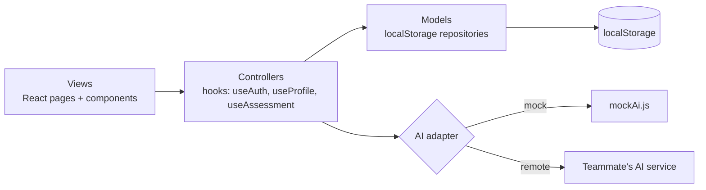
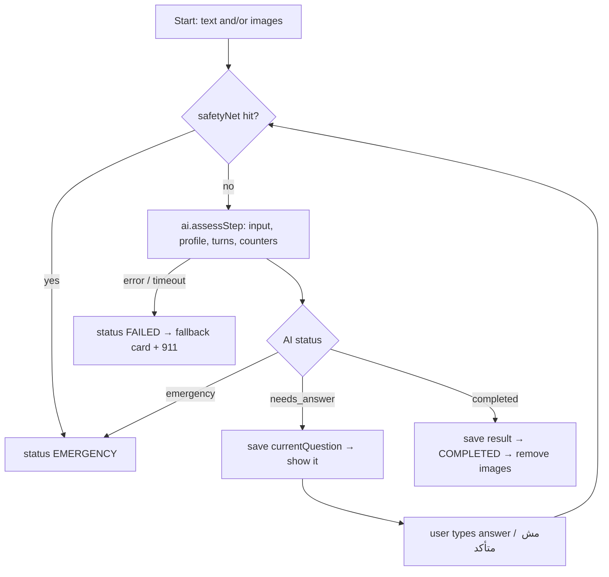

# MedicZero — Architecture (Frontend only · Mock data · localStorage)

> Historical design notes for the original frontend/mock prototype. The current
> app includes a FastAPI backend, always sends symptom assessments to `/ai/chat`,
> and does not run the old frontend keyword safety net in that flow. Extra rounds,
> profile extraction, and other planned behavior below are not guarantees of the
> current integration. See the [main README](README.md#architecture-and-assessment-flow)
> and [backend documentation](backend/README.md) for current behavior and setup.

> AI first-aid website for Jordan. The user describes an injury (text, image, or both). The site uses their health profile, asks questions until it is sure, then shows: the injury, the risk, what to do, suitable treatments, and whether to go to the ER.

**Simple competition MVP.**
- **No backend, no database.** Everything is a React app.
- **All data is saved in the browser's `localStorage`** (users, session, health profiles, assessments).
- **AI is mocked** inside the app. The real AI service (built by a teammate) plugs in later with one env change: `VITE_AI_MODE=remote`. Format: `docs/AI_CONTRACT.md`.
- No security work (passwords in plain text in localStorage is fine for the demo).

---

## 1. Overview



**MVC inside the frontend:**
| Layer | Folder | Job |
|---|---|---|
| **Model** | `src/models/` | Read/write data in localStorage (users, session, profiles, assessments). No UI. |
| **Controller** | `src/controllers/` (React hooks) | App logic: login, save profile, run the assessment flow, call the AI adapter, safety net. |
| **View** | `src/pages/`, `src/components/` | UI only. Gets data and actions from controllers. |

Later, if a real backend is added, only `src/models/` changes (localStorage → API calls). Controllers and views stay the same.

**Tech:** React + Vite, React Router, Tailwind CSS, lucide-react. No other libraries needed.

---

## 2. Folder structure

```
medic-zero/
├── CLAUDE.md
├── ARCHITECTURE.md
├── docs/AI_CONTRACT.md                  # send this to the AI teammate
└── frontend/
    ├── .env
    └── src/
        ├── main.jsx  App.jsx            # routes, <html dir="rtl" lang="ar">
        ├── index.css                    # Tailwind + design tokens (section 9)
        ├── models/                      # M
        │   ├── storage.js               # get/set JSON helpers + key names
        │   ├── userModel.js
        │   ├── sessionModel.js
        │   ├── profileModel.js
        │   └── assessmentModel.js
        ├── controllers/                 # C
        │   ├── AuthContext.jsx          # useAuth()
        │   ├── useProfile.js
        │   └── useAssessment.js         # the flow (section 6)
        ├── services/
        │   ├── safetyNet.js             # red-flag words (section 7)
        │   ├── imageUtils.js            # compress image to JPEG base64 (section 5.3)
        │   └── ai/
        │       ├── index.js             # picks mock or remote by VITE_AI_MODE
        │       ├── remoteAi.js          # fetch to teammate's API
        │       ├── mockAi.js            # fake AI (section 4)
        │       └── mockData.js          # questions, results, sample profile
        ├── data/
        │   ├── seed.js                  # demo user + profile created on first load
        │   └── fallbackCards.js         # simple first-aid cards if AI fails
        ├── pages/                       # V (section 8)
        └── components/                  # V (section 8)
```

---

## 3. Data in localStorage (Models)

All keys start with `mz_`. Values are JSON.

| Key | Content |
|---|---|
| `mz_users` | `[{ id, fullName, phone, password, createdAt }]` |
| `mz_session` | `{ userId }` or missing (logged out) |
| `mz_profiles` | `{ [userId]: Profile }` |
| `mz_assessments` | `[Assessment]` (each has `userId`) |

**Profile**
```json
{ "age": 45, "gender": "MALE", "weightKg": 82, "bloodType": "O+", "pregnant": null,
  "conditions": ["DIABETES", "HYPERTENSION"], "diabetesType": "TYPE2", "otherConditions": "",
  "allergies": ["البنسلين", "المكسرات"],
  "medications": [{ "name": "وارفارين", "dose": "5 ملغ", "frequency": "مرة يومياً", "isAnticoagulant": true }],
  "emergencyContact": { "name": "سارة", "phone": "0798765432" },
  "updatedAt": "2026-10-09T10:00:00Z" }
```
Condition codes: `DIABETES, HYPERTENSION, HEART_DISEASE, ASTHMA, KIDNEY_DISEASE, LIVER_DISEASE, EPILEPSY, BLEEDING_DISORDER, THYROID, IMMUNODEFICIENCY`.

**Assessment**
```json
{ "id": "uuid", "userId": "uuid", "createdAt": "...",
  "status": "QUESTIONING | COMPLETED | EMERGENCY | FAILED",
  "text": "انسكبت عليّ مي مغلية…", "images": [{ "mime": "image/jpeg", "base64": "..." }],
  "caseLabel": "حرق حراري – اليد اليمنى", "confidence": 0.72,
  "baseAsked": 5, "extraRounds": 1,
  "imageFindings": [], "profileFactors": [],
  "turns": [{ "index": 1, "questionId": "burn.onset", "question": "...", "why": "...",
              "isDanger": false, "isExtra": false, "endsRound": false, "answer": "...", "unsure": false }],
  "currentQuestion": { "id": "...", "text": "...", "why": "...", "isDanger": true, "isExtra": true, "endsRound": false },
  "result": null, "emergency": null }
```
`result` / `emergency` formats: `docs/AI_CONTRACT.md` §3.3 and §3.4.

**Model functions (examples)**
```js
// storage.js
export const read = (key, fallback) => JSON.parse(localStorage.getItem(key)) ?? fallback;
export const write = (key, value) => localStorage.setItem(key, JSON.stringify(value));

// userModel.js        create({fullName, phone, password}) · findByPhone(phone) · findById(id)
// sessionModel.js     get() · set(userId) · clear()
// profileModel.js     get(userId) · save(userId, profile) · remove(userId)
// assessmentModel.js  create(a) · update(id, patch) · get(id) · listByUser(userId) · removeImages(id)
```

**Seed (`data/seed.js`):** on first load, if `mz_users` is empty, create a demo user (phone `0790000000`, password `123456`) with the sample profile above, so the demo works instantly.

---

## 4. AI adapter

```js
// services/ai/index.js
import * as mock from './mockAi';
import * as remote from './remoteAi';
export default import.meta.env.VITE_AI_MODE === 'remote' ? remote : mock;
// ai.extractProfile(file)  → Promise<ProfileDraft>
// ai.assessStep(request)   → Promise<StepResponse>
```
Request / response formats are exactly `docs/AI_CONTRACT.md` §2 and §3.

**remoteAi.js:** `fetch(VITE_AI_SERVICE_URL + '/v1/assess/step', { method: 'POST', body: JSON })`, and multipart for `/v1/profile/extract`. 25 s timeout with `AbortController`. (The AI service must enable CORS.)

**mockAi.js:** same functions, same formats, ~1.2 s delay.
- `extractProfile(file)` → returns the sample profile (age 45, diabetes type 2, hypertension, penicillin allergy, warfarin + metformin).
- `assessStep(request)` follows the real question logic: **5 base questions**, then if confidence < 0.85 → **extra questions** (2 per round, last one `endsRound: true`), **max 3 rounds**. Scenario chosen by keywords:

| Scenario | Trigger (text / answers) | Ends with |
|---|---|---|
| Burn | حرق، انكوى، مي سخنة، زيت، burn | result: 2nd-degree superficial burn, MEDIUM; SEE_DOCTOR_24H if diabetic; ibuprofen "غير مناسب" if anticoagulant |
| Unclear fall | وقعت، انصدمت، التوى | 5 questions → confidence 0.72 → 2 extra questions → 0.88 → result: ankle sprain, LOW |
| Bleeding | نزيف، دم كثير، ما بيوقف، جرح عميق | emergency (immediately if profile has an anticoagulant and answer says it didn't stop) |
| Image only | no text + image | first asks شو صار؟ / إيمتى؟ / وين؟ → continues by the keywords in those answers |
| Other | anything else | 5 generic questions → generic result "راجع طبيب إذا…" |

All questions, results and emergency texts live in `mockData.js` (Arabic, from the Figma designs). Confidence in the mock grows with each answered question (e.g. +0.17 per base answer, cap by scenario).

---

## 5. Key flows

### 5.1 Sign up (3 steps)
1. **Account:** name, phone, password → `userModel.create` → `sessionModel.set`.
2. **Health profile:** age, gender, weight, blood type, pregnancy (female only), chronic diseases (chips), diabetes type, other conditions, allergies (tags), medications (list + "مميّع دم" checkbox), emergency contact. Optional **"Upload medical file"** → `ai.extractProfile(file)` → fills the form (user can edit).
3. **Review:** summary of everything → "إنهاء" → `profileModel.save` → go to `/assess/new`.

### 5.2 Login
Phone + password matched against `mz_users` → `sessionModel.set`. Protected routes redirect to `/login` if no session (except `/` and `/emergency`).

### 5.3 Images
`imageUtils.compress(file)` → canvas → max 1024 px, JPEG quality 0.7 → base64 (~100–200 KB). Max 3 images.
localStorage has ~5 MB, so **after an assessment ends, delete its images** (`assessmentModel.removeImages`) and keep only text results. If saving fails (quota), delete the oldest assessments' images and try again.

---

## 6. Assessment flow (`useAssessment.js`)



Controller API (what views use):
```js
const { assessment, loading, start, answer, goBack } = useAssessment(id);
start({ text, images })               // creates the assessment, runs the first step, returns id
answer({ answer, unsure })            // saves the turn, updates counters, runs next step
goBack()                              // removes last turn and asks that question again
```
Counters: after a base answer `baseAsked++`; after answering a question with `endsRound: true` → `extraRounds++`.
The safety net can only make it an emergency; it never cancels an emergency from the AI.

---

## 7. Safety net (`safetyNet.js`)
```js
const RED_FLAGS = ['ما بيتنفس','مش عم يتنفس','وقف نفسه','ازرق','مغمى عليه','فاقد الوعي','نزيف ما بيوقف',
  'دم كثير','الم بالصدر','وجع بالصدر','تشنجات','بلع كلور','بلع دوا','not breathing','unconscious'];
// normalize: remove diacritics, أ/إ/آ→ا, ة→ه, ى→ي, lowercase
export function check(text) → { hit, reasons }
```
Run on the initial text and every answer. On hit, use `fallbackCards.js` for the "until help arrives" steps.

---

## 8. Views

### Pages
| Route | Page | Login? |
|---|---|---|
| `/` | Home: hero + quick start, how it works, injury types, safety, CTA, emergency band, footer | no |
| `/login` | Login | no |
| `/signup` → `/signup/health` → `/signup/review` | 3-step sign-up | step 1 no |
| `/assess/new` | Switch: **اكتب الحالة** / **ارفع صورة فقط**; text optional when an image exists | yes |
| `/assess/:id` | Analyzing → question (typed answer) → extra question → result / emergency / fallback | yes |
| `/profile` | Edit health profile + "حذف بياناتي" (clears that user's localStorage data) | yes |
| `/history` | Past assessments list → open result | yes |
| `/emergency` | Static emergency guide + 911 | no |

### Components
- **Layout:** `Topbar` (logo, user, **911 always**), `PublicNavbar`, `Footer`, `AppLayout` (main + side panel)
- **UI:** `Button` `Input` `Textarea` `Select` `Checkbox` `Chip` `Tag` `Card` `Divider` `Stepper` `ProgressBar` `SegmentedControl`
- **Assessment:** `ImageDropzone` `PhotoTips` `AnalysisSteps` `QuestionCard` `AnswerBox` (textarea + "مش متأكد" + "السابق") `PrevAnswers` `ConfidenceNotice` `CaseSummaryCard` `ProfileFactorsCard` `ImageFindingsCard`
- **Result:** `ResultSummary` `RiskMeter` `CareDirection` `FirstAidSteps` `TreatmentTable` `GoToErCard` `AvoidCard` `ProfileImpactCard` `SourcesCard`
- **Emergency:** `EmergencyHero` (`tel:911`) `ParamedicCard` `FallbackCard`
- **Profile:** `ConditionChips` `AllergyTagInput` `MedicationList` `ProfileAutofill` `ProfileSummary`

Use the Figma file **"MedicZero – First Aid App" → page "v3 – Website (Clinical)"** as the visual reference for every page.

---

## 9. Design

```css
:root {
  --navy:#0B2545; --primary:#1E5AA8; --primary-soft:#EAF1FA;
  --bg:#F4F6F9; --surface:#FFFFFF; --border:#DDE2EA;
  --text:#111827; --muted:#5B6475; --placeholder:#98A2B3;
  --danger:#B42318; --danger-soft:#FEF3F2;
  --warning:#B54708; --warning-soft:#FFFAEB;
  --success:#067647; --success-soft:#ECFDF3;
  --font:"Noto Sans Arabic", sans-serif;   /* Google Fonts */
}
```
- RTL (`dir="rtl"`), radius 8–10 px, thin borders, no gradients.
- Desktop: main column + 360 px side panel. Mobile: side panel moves above the content, buttons full width, sticky main action at the bottom.
- File input on mobile: `accept="image/*" capture="environment"`.
- 911 button on every page. No doses in the UI. Say "تقييم مبدئي".

---

## 10. `.env`
```
VITE_AI_MODE=mock                       # mock | remote
VITE_AI_SERVICE_URL=http://localhost:8000
```

## 11. Run
```bash
cd frontend && npm i && npm run dev     # http://localhost:5173
```
To reset the demo: DevTools → Application → Local Storage → clear `mz_*` (or add a small "Reset demo" link in the footer in dev mode).

---

## 12. Build plan (for Claude Code)

| Step | Build | Check |
|---|---|---|
| 1 | Vite + React + Tailwind, RTL, tokens, font, router with empty pages | app runs, Arabic RTL |
| 2 | Models (`storage`, user, session, profile, assessment) + seed | demo user exists in localStorage |
| 3 | UI components + layouts (Topbar with 911, side panel) | matches Figma |
| 4 | Home page | matches Figma, responsive |
| 5 | Auth controller + login + 3-step sign-up with health profile + file autofill (mock) | profile saved in `mz_profiles` |
| 6 | AI adapter + mockAi + safety net + `useAssessment` | scenarios run in the console |
| 7 | New assessment page (write / image only) + assessment page (questions, extra, result, emergency, fallback) | burn, fall, bleeding, image-only all work |
| 8 | Profile, history, emergency page, mobile polish | works on phone size |
| 9 | Connect real AI: `VITE_AI_MODE=remote` | same scenarios work with teammate's AI |
